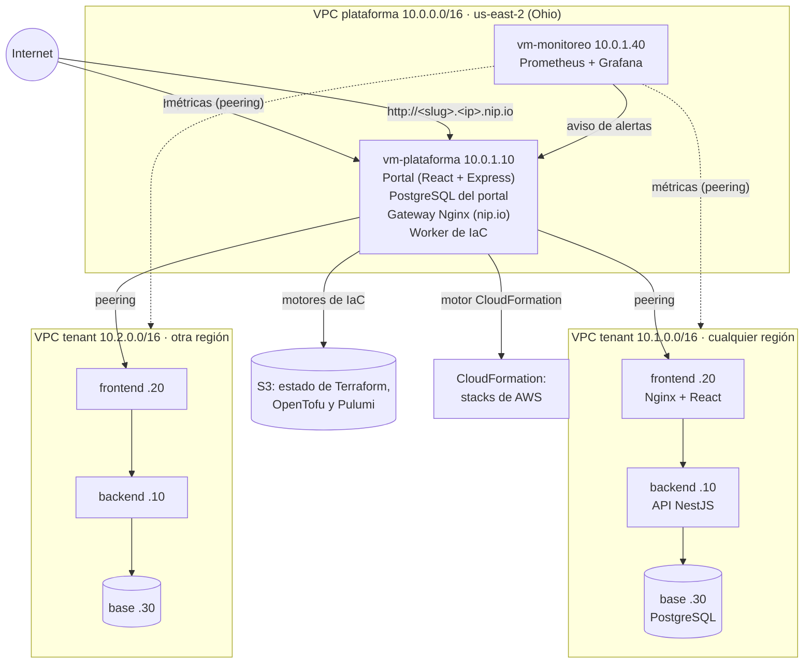
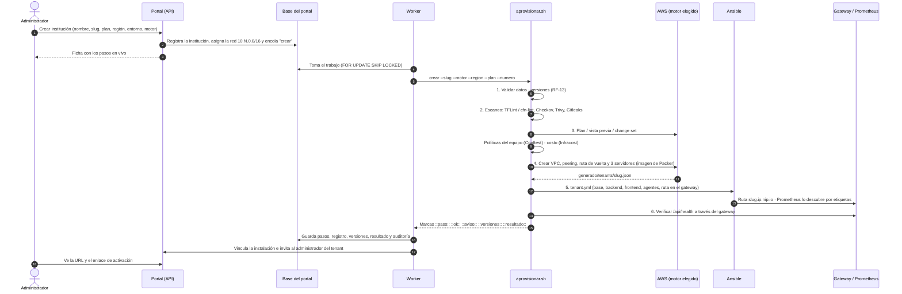

# Plataforma de tenants de asistencia: documentación del proyecto final

Diplomado Cloud Infrastructure & DevSecOps (FICCT, U.A.G.R.M.). Este documento reúne
los entregables escritos del proyecto: arquitectura, flujo de creación, catálogo de
planes, función de cada herramienta, instrucciones de operación, manejo del estado,
seguridad y evidencia de aislamiento. La guía paso a paso para levantar todo a mano
está en [LEEME.md](LEEME.md).

## Contenido

1. [Qué hace la plataforma](#1-qué-hace-la-plataforma)
2. [Arquitectura](#2-arquitectura)
3. [Flujo de creación de un tenant](#3-flujo-de-creación-de-un-tenant)
4. [Función de cada herramienta](#4-función-de-cada-herramienta)
5. [Catálogo de planes y límites](#5-catálogo-de-planes-y-límites)
6. [Operaciones de un tenant](#6-operaciones-de-un-tenant)
7. [Política de suspensión y retención](#7-política-de-suspensión-y-retención)
8. [Estado del motor de infraestructura](#8-estado-del-motor-de-infraestructura)
9. [Secretos y seguridad](#9-secretos-y-seguridad)
10. [Aislamiento entre tenants](#10-aislamiento-entre-tenants)
11. [Salud, métricas y alertas](#11-salud-métricas-y-alertas)
12. [Costos y limpieza](#12-costos-y-limpieza)
13. [Requisitos y dónde se cumplen](#13-requisitos-y-dónde-se-cumplen)
14. [Guion de la demostración](#14-guion-de-la-demostración)

---

## 1. Qué hace la plataforma

Cada **tenant** es una institución educativa con su propia copia de la aplicación de
asistencia (`admin-docente-alumno`): frontend, backend y base de datos en 3 servidores
propios, en una red propia. El **portal institucional** (`Admin-institucional`) es
donde el administrador de la plataforma:

- consulta y crea los **planes** (Básico, Estándar, Avanzado);
- **crea un tenant** eligiendo nombre, identificador, contacto, plan, entorno, región
  y **motor** (Terraform, OpenTofu, Pulumi o CloudFormation);
- sigue el **progreso** del aprovisionamiento paso a paso, con su registro;
- **suspende, reanuda y elimina** la infraestructura de cada tenant;
- consulta el **monitoreo** (métricas y alertas) y la **auditoría** de operaciones.

Usuarios:

| Usuario | Dónde trabaja | Qué hace |
| --- | --- | --- |
| Administrador de la plataforma | Portal `http://<ip plataforma>` | Planes, tenants, despliegues, métricas, auditoría |
| Administrador del tenant | App del tenant `http://<slug>.<ip>.nip.io` | Activa su cuenta con el enlace de invitación, administra su institución (docentes, módulos); recibe por correo las alertas de sus servicios |
| Docente y estudiante | App del tenant | Registro de asistencia según sus permisos |

---

## 2. Arquitectura



| Pieza | Qué es | Dónde está |
| --- | --- | --- |
| Plataforma | Se crea **una vez** con Terraform | `infra/plataforma/` |
| Tenant | Se crea **por institución** con el motor elegido | `infra/tenant/{terraform,pulumi,cloudformation}/` |
| Configuración | Ansible, igual para todos los motores | `infra/ansible/` |
| Imagen | AMI con todo preinstalado (Packer) | `infra/packer/` |
| Orquestación | Script que ejecuta el worker | `infra/scripts/aprovisionar.sh` |
| Reglas del equipo | Políticas Conftest (Rego) | `infra/politicas/` |

**Decisiones de diseño:**

- **Una VPC por tenant** (10.N.0.0/16): el aislamiento de red es estructural, no depende
  de reglas finas. El peering no es transitivo: un tenant llega a la plataforma, nunca a
  otro tenant.
- **Ninguna entrada desde internet a los tenants.** Todo el tráfico web entra por el
  gateway Nginx de la plataforma (`<slug>.<ip>.nip.io`) y viaja por el peering. Los
  servidores de los tenants tienen IP pública solo para salir (paquetes, GitHub).
- **Tres regiones** (us-east-2, us-east-1, us-west-2), hasta 2 tenants por región por la
  cuota de 16 vCPU. Un tenant en otra región usa peering entre regiones.
- **El mismo contrato para los 4 motores:** mismas entradas (slug, número de red,
  región, plan, entorno) y la misma salida (`generado/tenants/<slug>.json`), así Ansible,
  el gateway y el monitoreo no dependen del motor.
- **Trabajos en segundo plano:** el portal solo encola; el worker (`asistencia-worker`)
  ejecuta un trabajo a la vez y guarda pasos, registro, versiones y resultado.

---

## 3. Flujo de creación de un tenant



Qué detiene una creación y qué no:

| Detiene la creación | Solo avisa (queda en el registro) |
| --- | --- |
| Gitleaks encuentra un secreto en `infra/` | Hallazgos de TFLint, cfn-lint, Checkov y Trivy |
| Una regla `deny` de `politicas/`: tipo de servidor fuera del plan, disco sin cifrar, sin IMDSv2, un cambio que **borra o reemplaza** un recurso, falta la etiqueta de monitoreo | Reglas `warn` de `politicas/` |
| El motor falla (cuota, permisos, red) | Costo estimado de Infracost |

**Reintentar sin duplicar (RF-12):** si un trabajo falla, el botón **Reintentar
creación** vuelve a ejecutar el mismo script. Los 4 motores comparan con su estado y solo
crean lo que falta; Ansible es idempotente (`changed=0` si ya estaba).

---

## 4. Función de cada herramienta

| Herramienta | Función en esta arquitectura | Dónde |
| --- | --- | --- |
| **Terraform** | Motor principal: crea la plataforma y los tenants (VPC, subred, rutas, peering, grupos de seguridad, 3 instancias). Estado en S3 con bloqueo | `plataforma/`, `tenant/terraform/` |
| **OpenTofu** | El mismo código de Terraform con el binario `tofu`: demuestra que el código no depende del proveedor de la herramienta | `tenant/terraform/` |
| **Pulumi** (TypeScript) | Segunda implementación del tenant, con el mismo contrato. Backend S3 propio (sin Pulumi Cloud) | `tenant/pulumi/` |
| **CloudFormation** | Tercera implementación, nativa de AWS: plantilla YAML y change sets; el estado lo guarda AWS | `tenant/cloudformation/` |
| **cloud-init** | Configuración inicial al primer arranque: instala las claves SSH de la plataforma para que Ansible pueda entrar. Nada más | `user_data` de los 4 motores |
| **Packer** | Imagen `asistencia-tenant-<fecha>` con Node.js, Nginx, PostgreSQL, el código compilado y los agentes ya instalados, en las 3 regiones. Reduce la configuración de un tenant de 10-15 a 2-3 minutos | `packer/` |
| **Ansible** | Configuración posterior: lo propio de cada tenant (`.env`, contraseñas generadas, base de datos, migraciones, Nginx, agentes) y la ruta en el gateway. También configura la plataforma (portal, worker, Prometheus, Grafana). Packer reutiliza las mismas tareas | `ansible/` |
| **Grafana** | Paneles (Plataforma - Vista general, Tenant - Detalle), reglas de alerta y aviso al portal | `ansible/archivos/grafana/` |
| **Prometheus** | Guarda las métricas; descubre los servidores de los tenants por etiquetas de EC2 (`Proyecto`, `Tenant`, `Plan`, `Entorno`, `Rol`) | `ansible/tareas/prometheus.yml` |
| **Agentes** | node_exporter (sistema), process-exporter (procesos), OpenTelemetry Collector (Nginx, salud de la API, errores 5xx, PostgreSQL), Netdata (en vivo) | `ansible/tareas/` |
| **Escáneres** | TFLint / cfn-lint, Checkov, Trivy, Gitleaks, Conftest, Infracost: seguridad y reglas del equipo antes de crear | `scripts/aprovisionar.sh`, `politicas/` |

---

## 5. Catálogo de planes y límites

Todos los servidores tienen 2 vCPU; los planes se distinguen por la memoria y el disco.
Los tipos son de la capa gratuita de AWS (`tenant/terraform/locales.tf`, el mismo
cuadro en Pulumi y CloudFormation, y en la base del portal).

| | Básico | Estándar | Avanzado |
| --- | --- | --- | --- |
| Para | Una institución que empieza | Más estudiantes y registros | Mayor volumen |
| Frontend | t3.micro · 1 GB RAM | t3.small · 2 GB | t3.small · 2 GB |
| Backend | t3.small · 2 GB RAM | c7i-flex.large · 4 GB | m7i-flex.large · 8 GB |
| Base de datos | t3.small · 2 GB RAM | c7i-flex.large · 4 GB | m7i-flex.large · 8 GB |
| Disco de cada servidor (gp3, cifrado) | 20 GB | 30 GB | 40 GB |
| Disco de la base de datos | 20 GB | 30 GB | 40 GB |
| Límite de estudiantes (referencia) | 100 | 1 000 | 5 000 |
| Respaldo automático (retención) | Semanal (últimos 4) | Diario (últimos 7) | Diario con retención ampliada (últimos 30) |
| vCPU en total | 6 | 6 | 6 |

Notas:

- El administrador de la plataforma ve el catálogo en **Planes** y puede crear planes
  nuevos (con sus instancias de referencia). Solo Básico, Estándar y Avanzado tienen
  infraestructura definida en los motores.
- Las políticas del equipo (`politicas/`) rechazan cualquier tipo de servidor que no esté
  en la lista permitida, con los 4 motores.
- El **respaldo** se hace solo con la frecuencia del plan y conserva los últimos 4, 7 o 30
  ([6.6](#66-respaldar-y-restaurar)).
- El **límite de estudiantes** corresponde al requisito opcional RF-05: hoy es un valor de
  referencia del plan.

---

## 6. Operaciones de un tenant

Todas las operaciones del portal son **trabajos en segundo plano**: se ven sus pasos y su
registro en vivo (con botón **Ver en grande**), quedan en el historial del tenant y en
**Auditoría** (quién, cuándo, resultado, duración y versiones).

### 6.1 Crear

1. Portal → **Crear institución**.
2. Completar nombre, identificador (slug, 3-30 caracteres), administrador y correo,
   plan, región, entorno y motor → **Crear institución**.
3. Se abre la ficha con los 6 pasos. Ansible tarda 2-3 minutos con la imagen de Packer
   y 10-15 sin ella; sumando el motor, la creación completa tarda entre 10 y 20 minutos.
4. Al terminar: la URL `http://<slug>.<ip>.nip.io` y el **enlace de activación** del
   administrador del tenant (vista previa en el panel; no se envía correo).

Si falla: el paso en rojo dice por qué; **Reintentar creación** retoma sin duplicar.

### 6.2 Actualizar la aplicación y la infraestructura

La aplicación se actualiza volviendo a aplicar Ansible (descarga el último commit de la
rama `plataforma`, recompila solo si cambió y reinicia los servicios):

```bash
ssh ec2-user@<ip plataforma>
sudo -iu iac                                   # queda en /opt/iac/repo/infra
git -C .. pull                                 # o: plataforma.yml actualiza esta copia
python3 scripts/inventario.py <slug> --en-plataforma
cd ansible && ansible-playbook -i inventarios/<slug>.ini tenant.yml -e tenant_invitacion=true
```

La infraestructura se actualiza con el mismo motor que la creó: cambiar el código en
`tenant/<motor>/` y volver a ejecutar `aprovisionar.sh crear` con los mismos datos (el
motor calcula solo la diferencia; las políticas rechazan los cambios que borran o
reemplazan servidores). Cada ejecución registra sus versiones (RF-13).

### 6.3 Suspender

Instituciones → el tenant → **Suspender**. Apaga los 3 servidores (`stop-instances`)
buscándolos por sus etiquetas, igual con los 4 motores. Ver la
[política](#7-política-de-suspensión-y-retención).

### 6.4 Reanudar

**Reanudar** enciende los servidores y espera a que `/api/health` responda a través del
gateway (hasta 5 minutos). Conservan su IP privada, sus datos y su configuración.

### 6.5 Eliminar

**Eliminar infraestructura** muestra, antes de confirmar, la lista concreta de lo que se
borra (RF-18): región y motor; la VPC 10.N.0.0/16 con su subred, rutas, internet gateway
y grupos de seguridad; el peering y la ruta en la plataforma; los 3 servidores con su tipo
y disco; **los datos de la base**; la ruta del gateway y el monitoreo; el estado del motor.
Para confirmar hay que escribir el identificador del tenant.

Se conserva: el registro de la institución, el historial de trabajos, la auditoría, las
contraseñas archivadas en `generado/borrados/<slug>-<fecha>/` del servidor y los
**respaldos** en S3 (hasta 90 días).

### 6.6 Respaldar y restaurar

Instituciones → el tenant → **Respaldos de la base de datos** (RF-19):

- **Respaldar ahora:** el worker entra a la base del tenant, hace `pg_dump` y guarda el
  archivo en el bucket privado y cifrado `asistencia-respaldos-<cuenta>`
  (`tenants/<slug>/<fecha>.dump`). Queda en la lista con fecha, tamaño y si fue manual o
  programado.
- **Programado según el plan:** Básico, semanal (se conservan 4); Estándar, diario (7);
  Avanzado, diario con retención ampliada (30). El primero se hace una hora después de que
  la infraestructura queda lista. Los que exceden la retención se borran de S3, y S3 borra
  cualquier respaldo de más de 90 días.
- **Restaurar:** botón **Restaurar** en un respaldo, con confirmación (escribir el
  identificador). La copia se carga primero en una base aparte; recién si terminó bien se
  detiene la API unos segundos, se intercambian las bases y se verifica `/api/health`. Si
  algo falla antes, la base actual no se toca; si falla la verificación, la anterior queda
  guardada como `asistencia_anterior`.
- Necesita la infraestructura **encendida** (reanudar si está suspendida). Los respaldos
  **se conservan al eliminar** la infraestructura: se pueden restaurar al volver a crearla.
- Todo queda en Auditoría (quién lo pidió, archivo, tamaño, resultado).

Por línea de comandos (como el worker), en el servidor de la plataforma como `iac`:

```bash
bash scripts/aprovisionar.sh respaldar --slug <slug> --motor <motor> --region <region> --plan <plan> --numero <N>
bash scripts/aprovisionar.sh restaurar --slug <slug> ... --respaldo tenants/<slug>/<fecha>.dump
```

---

## 7. Política de suspensión y retención

| Estado | Servidores | Datos de la base | Costo | Monitoreo |
| --- | --- | --- | --- | --- |
| **Activa** | Encendidos | En el disco del servidor `base` | Cómputo + discos | Prometheus y alertas |
| **Suspendida** | Apagados (`stopped`) | **Se conservan** completos y sin límite de tiempo | Solo los discos gp3 (sin horas de cómputo ni vCPU de la cuota) | Prometheus deja de verlos; el gateway responde 502 |
| **Eliminada** | Borrados | Se pierden de los servidores; **quedan los respaldos** en S3 (hasta 90 días) | Solo los respaldos en S3 | — |

- Suspender **no** toca el estado del motor: al reanudar no hay que volver a aplicar nada.
- Al reanudar, los servidores mantienen su IP privada (la red y el gateway siguen igual);
  la IP pública de salida puede cambiar, lo que no afecta a nada porque no se usa para
  entrar.
- La infraestructura eliminada deja la institución con la etiqueta **Infraestructura
  eliminada** y su historial completo.

---

## 8. Estado del motor de infraestructura

| Motor | Dónde está el estado | Bloqueo | Protección |
| --- | --- | --- | --- |
| Terraform / OpenTofu | S3 `tfstate-asistencia-<cuenta>`, clave `tenants/<slug>/terraform.tfstate` (plataforma: `proyecto/plataforma/terraform.tfstate`) | `use_lockfile = true` (archivo `.tflock` en S3, Terraform ≥ 1.10) | `encrypt = true` (cifrado en el servidor de S3); acceso solo con el rol IAM del worker o tu usuario |
| Pulumi | El mismo bucket, prefijo `pulumi/` (backend S3, sin Pulumi Cloud); un stack por tenant | El worker ejecuta un trabajo a la vez, así nunca hay dos `pulumi up` sobre el mismo stack | Los valores secretos del stack se cifran con `PULUMI_CONFIG_PASSPHRASE` (en Ansible Vault); `Pulumi.<slug>.yaml` solo guarda entradas y la sal de cifrado |
| CloudFormation | AWS guarda el estado de los stacks `tenant-<slug>` y `tenant-<slug>-ruta` | CloudFormation no permite dos actualizaciones a la vez | Change sets revisados por las políticas antes de ejecutar |

- **Un estado por tenant:** un error en uno no afecta a los demás, y borrar un tenant
  borra solo su estado.
- **Nunca en el repositorio:** `.gitignore` excluye `*.tfstate`, `.terraform/`, los
  planes y `generado/` (inventarios, contraseñas y salidas de cada tenant).
- **El estado puede tener datos sensibles** (por ejemplo, salidas): por eso el bucket es
  privado y cifrado, y los servidores acceden con roles IAM, no con claves.
- Comprobar la configuración del bucket:
  ```powershell
  aws s3api get-bucket-versioning --bucket tfstate-asistencia-<cuenta>
  aws s3api get-public-access-block --bucket tfstate-asistencia-<cuenta>
  aws s3api get-bucket-encryption --bucket tfstate-asistencia-<cuenta>
  ```

---

## 9. Secretos y seguridad

| Secreto | Dónde vive | Cómo se protege |
| --- | --- | --- |
| Contraseñas de la plataforma (portal, base, Grafana), frase de Pulumi, SMTP | `ansible/group_vars/all/vault.yml` | Cifrado con Ansible Vault; en git solo la versión cifrada y un `vault.yml.ejemplo` |
| Contraseñas de cada tenant (base, JWT, monitoreo, clave de vinculación) | `generado/tenants/<slug>/` en el servidor | Generadas al azar por Ansible (`lookup password`), distintas por tenant; `generado/` está en `.gitignore` |
| Token de alertas Grafana → portal | `generado/alertas-token` | Generado al azar; el gateway solo acepta el aviso desde la red privada |
| Credenciales de AWS | Roles IAM de las instancias | Sin claves de acceso en los servidores ni en el código |
| Acceso SSH | `claves/*.pub` (solo públicas) | La privada queda en tu equipo; los tenants solo aceptan SSH desde la red de la plataforma |

Medidas adicionales:

- **Gitleaks** revisa `infra/` en cada creación y la detiene si encuentra un secreto.
- Discos **cifrados** e **IMDSv2 obligatorio** en todos los servidores (y las políticas
  rechazan lo contrario).
- Las tareas de Ansible con contraseñas usan `no_log` / `diff: false`; los errores que
  muestra el portal son los resúmenes de los pasos, sin variables ni contraseñas.
- El administrador del tenant crea su propia contraseña con un enlace de un solo uso
  (24 h); la plataforma no la conoce.

---

## 10. Aislamiento entre tenants

### Diseño

| Capa | Cómo se aísla |
| --- | --- |
| Red | Una VPC por tenant (10.N.0.0/16). El peering conecta cada tenant **solo** con la plataforma y no es transitivo |
| Grupos de seguridad | Web (80) y SSH/monitoreo solo desde 10.0.0.0/16 (plataforma); la API (3000) solo desde el frontend del mismo tenant; PostgreSQL (5432) solo desde el backend del mismo tenant |
| Internet | Ningún puerto de los tenants está abierto a internet; se entra solo por el gateway |
| Datos | Cada tenant tiene su propio servidor PostgreSQL, su base y su usuario con contraseña distinta |
| Aplicación | Cada tenant tiene su propio `JWT_SECRET`: un token de un tenant no sirve en otro |

### Pruebas (evidencia)

Ejecutar desde el servidor de la plataforma como `iac`, en `infra/ansible`, con dos
tenants creados (A = `utepsa` en 10.1, B = `la-salle` en 10.2; ajustar a los reales).
Guardar las salidas o capturas como evidencia.

| # | Prueba | Comando | Resultado esperado |
| --- | --- | --- | --- |
| 1 | El frontend de A no llega al frontend de B | `ansible utepsa-frontend -i inventarios/utepsa.ini -m shell -a "timeout 3 bash -c '</dev/tcp/10.2.1.20/80' && echo ABIERTO \|\| echo CERRADO"` | `CERRADO` |
| 2 | El backend de A no llega a la base de B | `ansible utepsa-backend -i inventarios/utepsa.ini -m shell -a "timeout 3 bash -c '</dev/tcp/10.2.1.30/5432' && echo ABIERTO \|\| echo CERRADO"` | `CERRADO` |
| 3 | La plataforma sí llega a ambos | `timeout 3 bash -c '</dev/tcp/10.2.1.20/80' && echo ABIERTO` (en vm-plataforma) | `ABIERTO` |
| 4 | Ni el frontend de A llega a la base de A | `ansible utepsa-frontend -i inventarios/utepsa.ini -m shell -a "timeout 3 bash -c '</dev/tcp/10.1.1.30/5432' && echo ABIERTO \|\| echo CERRADO"` | `CERRADO` (solo el backend entra a su base) |
| 5 | Desde internet no se entra a un tenant | `curl -m 5 http://<ip pública del frontend de A>` (desde tu equipo) | Sin respuesta (timeout) |
| 6 | Un token de A no sirve en B | Iniciar sesión en `http://utepsa.<ip>.nip.io`, copiar el token y llamar a `http://la-salle.<ip>.nip.io/api/...` con `Authorization: Bearer <token>` | `401` |
| 7 | Cada uno ve solo sus datos | Crear un docente en A y buscarlo en B | No aparece en B |

Para preparar las pruebas: `python3 scripts/inventario.py <slug> --en-plataforma` para
cada tenant (ver [6.2](#62-actualizar-la-aplicación-y-la-infraestructura)).

---

## 11. Salud, métricas y alertas

| Requisito | Cómo se cumple |
| --- | --- |
| RF-25 Grafana por tenant | Paneles **Plataforma - Vista general** y **Tenant - Detalle** (variable `tenant`), con enlace desde cada tarjeta de Monitoreo del portal |
| RF-26 Disponibilidad, CPU, memoria, latencia, errores, base | API `/api/health` (http_check), agentes `up`, CPU/memoria/disco (node_exporter), latencia de la API, **errores 5xx** (registro de `/api` contado por el Collector), conexiones, tamaño y transacciones de PostgreSQL |
| RF-27 Por tenant y por entorno | Variables `entorno` y `tenant` en Grafana; filtro de entorno en Monitoreo del portal |
| RF-28 Alertas | Servidor o agente sin respuesta, API sin respuesta, servicio detenido, CPU > 85 %, memoria > 90 %, disco > 85 %, conexiones de PostgreSQL > 80 %, **más de 5 errores 5xx en 5 minutos** |
| RF-29 Alertas y eventos en la plataforma | Grafana avisa al portal; Monitoreo muestra las alertas activas (tenant, servidor, hora de detección) y los eventos de las últimas 24 h. Correo opcional al operador y al administrador del tenant. Las alertas de un tenant durante un trabajo de la plataforma (o hasta 10 minutos después) se marcan "durante el despliegue" y no envían correo |

**Alerta de ejemplo para la demo:** detener la API de un tenant
(`ansible <slug>-backend -i inventarios/<slug>.ini -b -m systemd -a "name=asistencia-api state=stopped"`).
En 1-2 minutos aparece "La API no responde" en Grafana y en Monitoreo del portal (y llega
el correo si está configurado). Con `state=started` se resuelve sola y pasa a eventos
recientes.

---

## 12. Costos y limpieza

- Los planes usan tipos de la capa gratuita; cada tenant ocupa 6 vCPU. **Suspender** deja
  de consumir cómputo; solo quedan los discos.
- Cuotas por región: 16 vCPU y 5 VPC. El portal admite 2 tenants por región
  (`PLATFORM_TENANTS_PER_REGION`).
- Infracost estima el costo mensual en el paso 3 (con clave gratuita en el vault).
- **Limpieza al terminar las pruebas:** eliminar cada tenant desde el portal y después la
  plataforma con `terraform destroy` en `infra/plataforma` (ver [LEEME.md](LEEME.md#6-borrar)).
  Comprobar que no quedan instancias:
  ```powershell
  foreach ($r in "us-east-2","us-east-1","us-west-2") {
    aws ec2 describe-instances --region $r --filters "Name=tag:Proyecto,Values=asistencia" "Name=instance-state-name,Values=running,stopped" --query "Reservations[].Instances[].[Tags[?Key=='Name']|[0].Value,State.Name]" --output table
  }
  ```

---

## 13. Requisitos y dónde se cumplen

Los requisitos tachados en el documento del proyecto son opcionales (marcados *opc.*).

| Requisito | Estado | Dónde |
| --- | --- | --- |
| RF-01 Catálogo de planes | ✅ | Portal → Planes; sitio público |
| RF-02 Recursos por plan | ✅ | [Catálogo](#5-catálogo-de-planes-y-límites); `locales.tf`; base del portal |
| RF-03 Elegir plan y ver características | ✅ | Formulario de creación y solicitud pública |
| RF-04 Modificar planes *(opc.)* | Parcial | Portal → Planes → crear plan |
| RF-05 Límites del plan *(opc.)* | Pendiente | Límite de estudiantes de referencia |
| RF-06 Cambiar plan *(opc.)* | Pendiente | — |
| RF-07 Crear con nombre, slug, contacto, entorno y plan | ✅ | Crear institución |
| RF-08 Elegir el motor | ✅ | Terraform, OpenTofu, Pulumi, CloudFormation |
| RF-09 Recursos de frontend, backend y base | ✅ | `tenant/<motor>/` |
| RF-10 Desplegar la app y conectarla a su base | ✅ | `ansible/tenant.yml` |
| RF-11 Progreso, resultado y errores comprensibles | ✅ | Pasos y registro en vivo |
| RF-12 Reintentar sin duplicar | ✅ | Reintentar creación (estado del motor + Ansible idempotente) |
| RF-13 Versiones en cada despliegue | ✅ | "Versiones usadas en este trabajo" y Auditoría |
| RF-14 Consultar por nombre, estado, plan y entorno | ✅ | Instituciones: buscador y filtros |
| RF-15 Actualizar app e infraestructura *(opc.)* | Manual | [6.2](#62-actualizar-la-aplicación-y-la-infraestructura) |
| RF-16 Suspender y reanudar | ✅ | Botones Suspender / Reanudar |
| RF-17 Suspensión y retención | ✅ | [Política](#7-política-de-suspensión-y-retención) |
| RF-18 Mostrar qué se elimina y confirmar | ✅ | Resumen antes de eliminar + escribir el slug |
| RF-19 Respaldar y restaurar *(opc.)* | ✅ | Respaldos de la base de datos: manual, programado y restaurar ([6.6](#66-respaldar-y-restaurar)) |
| RF-20 Quién, cuándo y resultado *(opc.)* | ✅ | Auditoría |
| RF-21 Requisitos de la app | ✅ | `admin-docente-alumno` |
| RF-25 a RF-29 Salud, métricas y alertas | ✅ | [Sección 11](#11-salud-métricas-y-alertas) |
| Aislamiento de datos | ✅ | [Sección 10](#10-aislamiento-entre-tenants) |
| Secretos fuera del código | ✅ | [Sección 9](#9-secretos-y-seguridad) |
| Trabajos en segundo plano consultables | ✅ | Worker + `platform_jobs` |
| Historial de operaciones y resultados | ✅ | Historial del tenant, Auditoría |
| Operaciones repetibles | ✅ | Motores con estado, Ansible idempotente, políticas |
| Documentar el estado del motor | ✅ | [Sección 8](#8-estado-del-motor-de-infraestructura) |
| Errores sin secretos | ✅ | Resúmenes por paso, `no_log` |
| Detener o eliminar recursos de prueba | ✅ | Suspender, Eliminar, [limpieza](#12-costos-y-limpieza) |

---

## 14. Guion de la demostración

Crear un tenant tarda entre 10 y 20 minutos: conviene tener **tenants ya creados** (por ejemplo
2-3 con planes y motores distintos) y crear **uno solo en vivo** al principio.

| Min | Qué mostrar | Criterio de aceptación |
| --- | --- | --- |
| 0-3 | Arquitectura ([sección 2](#2-arquitectura)) y función de cada herramienta | Explicar el diseño |
| 3-6 | Crear un tenant en vivo (plan distinto, otro motor): pasos, escáneres, registro en grande | Crear tenants con distintos planes |
| 6-9 | Un tenant ya creado: abrir su URL, activar el administrador, crear un docente | Desplegar frontend, backend y base |
| 9-12 | Filtros de Instituciones, versiones del despliegue y Auditoría | Historial y versiones |
| 12-15 | Suspender un tenant (Monitoreo lo muestra suspendido), reanudar y comprobar que sus datos siguen | Suspender y reanudar conservando datos |
| 15-19 | Grafana (vista general y detalle) y la alerta de ejemplo hasta verla en el portal | Salud en Grafana y alerta de ejemplo |
| 19-22 | Pruebas de aislamiento 1, 2 y 6 ([sección 10](#10-aislamiento-entre-tenants)) | Un tenant no consulta datos de otro |
| 22-24 | Eliminar un tenant: el resumen de recursos y la confirmación | Eliminar con confirmación |
| 24-25 | Volver al tenant creado en vivo: ya terminó | — |

Al terminar la presentación: [limpieza](#12-costos-y-limpieza).
